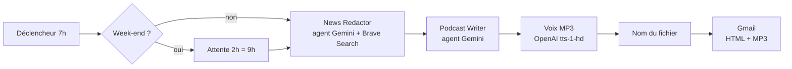

# ☀️ Briefing matinal automatisé : n8n + Gemini + Brave Search

Un workflow [n8n](https://n8n.io) qui envoie chaque matin, par Gmail :

- un **mail HTML moderne** (météo, football de la veille avec scores exacts, actualités par rubrique, « ce jour dans l'histoire », citation) ;
- un **podcast MP3 d'environ 3 minutes**, drôle sur les sujets légers et sobre sur les sujets graves, qui suit la trame du mail ;
- le **dimanche**, en plus, un **résumé de la semaine**.

L'aperçu du rendu (données fictives) est dans [`Workflow.ts/docs/exemple-briefing.html`](Workflow.ts/docs/exemple-briefing.html).

## Fonctionnement



| Étape | Nœud | Rôle |
|---|---|---|
| 1 | `Every Day at 07:00AM` | Déclenche le workflow tous les jours à 7h (Europe/Paris) |
| 2 | `If It Is Week End` + `Delay 2h` | Samedi et dimanche, attend 2h pour envoyer à 9h |
| 3 | `News Redactor` | Agent IA : fait au moins 10 recherches Brave, rédige le mail HTML |
| 4 | `Podcast Writer` | Agent IA : transforme le briefing en script oral humoristique |
| 5 | `Podcast Voice (MP3)` | Synthèse vocale (voix `nova`) |
| 6 | `Nom du fichier MP3` | Nomme la pièce jointe `briefing-AAAA-MM-JJ.mp3` |
| 7 | `Send Final Mail` | Envoie le mail HTML avec le MP3 en pièce jointe |

**Résilience.** Chaque agent a un modèle principal (`gemini-flash-latest`) et un modèle de secours (`gemini-flash-lite-latest`). Les appels sont relancés en cas d'erreur (par exemple un 503 « high demand » de Gemini).

## Installation

1. **Prérequis** : une instance n8n (Cloud ou auto-hébergée) et le nœud communautaire `@brave/n8n-nodes-brave-search`.
2. **Importer** [`Workflow.ts/workflow/briefing-matinal.json`](Workflow.ts/workflow/briefing-matinal.json) : *Workflows → Import from file*.
3. **Associer les identifiants** (aucun identifiant n'est versionné dans ce dépôt) :

   | Nœuds | Identifiant à créer |
   |---|---|
   | `Using Gemini*` (4 nœuds) | Google Gemini (PaLM) API |
   | `Searching On Internet` | Brave Search API |
   | `Podcast Voice (MP3)` | OpenAI API (ou crédits Gateway n8n Cloud) |
   | `Send Final Mail` | Gmail OAuth2 |

4. **Changer le destinataire** dans `Send Final Mail` (champ *To*, `votre.adresse@example.com` par défaut).
5. **Tester** avec *Execute workflow* : un vrai mail est envoyé à chaque test.
6. **Activer** le workflow (bouton *Publish*) pour lancer le planning quotidien.

## Personnalisation

| Je veux… | Je modifie… |
|---|---|
| Changer l'heure d'envoi | `Every Day at 07:00AM` (heure) et `Delay 2h` (décalage week-end) |
| Changer la voix | `Podcast Voice (MP3)` → *Voice* (`alloy`, `echo`, `fable`, `onyx`, `nova`, `shimmer`) |
| Changer la longueur du podcast | `Workflow.ts/prompts/podcast-writer.user.md` (bloc `<duree_et_longueur>`) |
| Changer les rubriques ou le ton | `Workflow.ts/prompts/news-redactor.user.md` et `Workflow.ts/prompts/podcast-writer.user.md` |
| Changer de modèle | Les 4 nœuds `Using Gemini*` |

## Les prompts

Les prompts suivent une structure XML unique, du même modèle pour les deux agents :

```
<role>          → message système de l'agent
<instructions>
  <goal>        → objectif
  <context>     → contexte, règles de fidélité, contraintes
  <examples>    → 3 exemples fictifs et très variés
  <output_format>
</instructions>
<inputs>        → variables du jour injectées par n8n (dates, briefing…)
```

Ils sont stockés en fichiers lisibles dans [`Workflow.ts/prompts/`](Workflow.ts/prompts/), puis injectés dans le workflow par le script de build :

```bash
python3 Workflow.ts/scripts/build_workflow.py   # régénère Workflow.ts/workflow/briefing-matinal.json
```

**Règles anti-erreurs** (les erreurs factuelles sont le principal risque d'un briefing généré par IA) :

- au moins 10 recherches distinctes avant d'écrire ;
- chaque fait doit être appuyé par un extrait de recherche daté, sans rien ajouter ;
- « prévu / devrait / étudie » ne deviennent jamais « adopté / validé / décidé » ;
- les faits de plus de 2 jours sont datés ; les titres de pages d'accueil sans détail sont écartés ;
- football : 5 matchs maximum, scores exacts uniquement, deux recherches obligatoires avant d'écrire « Pas de grand match hier ».

## Limites connues

- **Pas de vérification indépendante.** Les extraits Brave sont courts (souvent des titres de pages d'accueil) et le modèle peut paraphraser trop librement. Les règles ci-dessus réduisent le risque sans le supprimer : relire le mail reste nécessaire pour un usage critique.
- Le podcast peut contenir de petites erreurs d'oral (sigles ou numéros d'unités militaires mal prononcés).
- Les tests envoient de vrais mails et consomment des crédits d'API (Gemini, Brave, synthèse vocale).

## Pistes d'amélioration

- Passer les actualités par l'opération `news` de Brave (articles datés) plutôt que par la recherche web.
- Ajouter un second agent qui vérifie chaque fait du mail contre les extraits avant l'envoi.
- Faire de la structure des prompts un modèle réutilisable pour d'autres briefings.

## Structure du dépôt

```
.
├── README.md
└── Workflow.ts/
    ├── LICENSE
    ├── .gitignore
    ├── docs/
    │   └── exemple-briefing.html        aperçu du rendu (données fictives)
    ├── prompts/
    │   ├── news-redactor.system.md      rôle de l'agent de rédaction
    │   ├── news-redactor.user.md        instructions, exemples, format, inputs
    │   ├── podcast-writer.system.md     rôle de l'animateur du podcast
    │   └── podcast-writer.user.md       instructions, exemples, format, inputs
    ├── scripts/
    │   └── build_workflow.py            génère le JSON du workflow
    └── workflow/
        └── briefing-matinal.json        workflow n8n importable
```

## Licence

[MIT](Workflow.ts/LICENSE)
